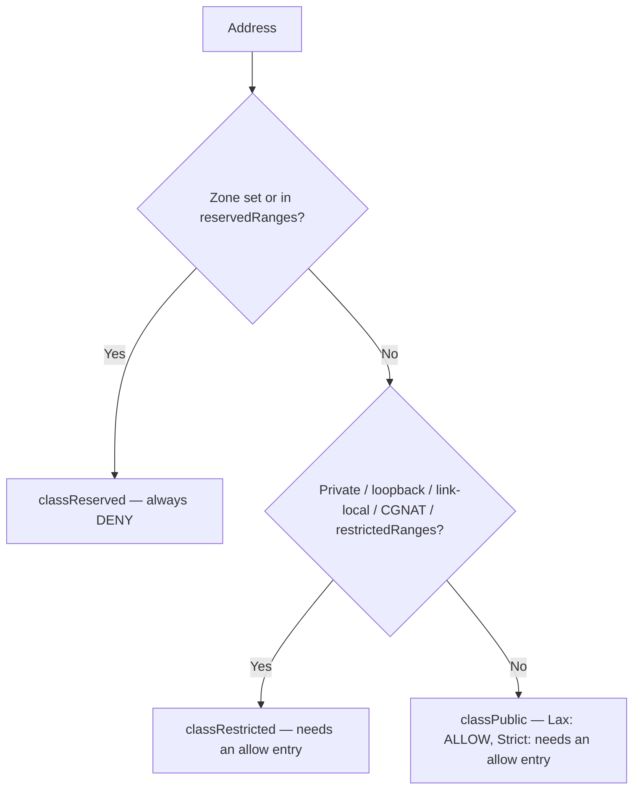

# ADR: Egress Policy Design for Gitea

**Status**: Accepted
**Date**: 2026-10-06
**Author**: TheFox0x7
**Related Code**: `@modules/egress/policy`, `@modules/egress/policies.go`

## Context

Gitea makes outbound HTTP connections for webhooks, migrations, git operations, avatar fetching, and more. Without controls, these are an SSRF vector: an attacker with repo-admin rights could point a webhook at `169.254.169.254` and read cloud credentials, or target internal services.

## Decision

A **dual-list policy system** (allow + block) with two modes — **Lax** (public targets allowed by default) and **Strict** (everything needs an explicit allow entry) — enforced at the network dial level, not just at request time.

Key properties:

- **Dial-time enforcement**: the resolved IP is checked in the `Dialer.Control` callback, after DNS resolution but before connect. DNS rebinding can't bypass it.
- **Three address classes**: *reserved* (never dialable — multicast, "this network", IPv4-embedding ranges), *restricted* (private, loopback, link-local, CGNAT and special-use ranges — dialable only with an explicit allow entry), *public* (allowed by default in Lax mode).
- **Hostname entries never cover restricted targets alone**: a hostname allow entry like `internal.example.com` does not match a restricted IP by itself. The dial-time check resolves the hostname and verifies the actual IP. A hostname entry covers restricted targets only within `ALLOWED_INTERNAL_RANGES`, and only for the exact host (see "Internal Ranges for Hostname Entries").
- **Proxies are operator config, not user input**: when a proxy is selected, the dial goes to the proxy (exempt from checks) and the target is not IP-checked locally. The proxy is expected to carry the egress restrictions. The one exception is the webhook-specific proxy, which still screens the target hostname before the request is handed over.
- **Per-component policies**: migrations, git, webhooks, and general security each get their own policy instance with their own settings, defined in one place (`policies.go`).

## Integration

Each outbound flow gets its own policy instance, wired in `policies.go`:

| Policy | Used by | Mode | Allow list | Internal ranges | Block list | Proxy |
|---|---|---|---|---|---|---|
| Migration | `services/migrations/` | `[migrations] EGRESS_MODE` | `[migrations] ALLOWED_HOST_LIST` | `[migrations] ALLOWED_INTERNAL_RANGES` | `[migrations] BLOCKED_HOST_LIST` | Standard (`[proxy] PROXY_URL`, env) |
| Git | `services/gitproxy/` | same as Migration | same as Migration | same as Migration | same as Migration | Git's own (`[git.config] http.proxy`, `[proxy] PROXY_URL`, env, `ALL_PROXY`) |
| Webhook | `services/webhook/` | `[security] EGRESS_MODE` | `[webhook] ALLOWED_HOST_LIST` (defaults to `[security]`) | `[security] ALLOWED_INTERNAL_RANGES` | — | `[webhook] PROXY_URL` / `PROXY_HOSTS`, falls back to standard |
| Security | OpenID, OAuth2 avatars | `[security] EGRESS_MODE` | `[security] ALLOWED_HOST_LIST` | `[security] ALLOWED_INTERNAL_RANGES` | — | Standard |

Only Migration and Git have a block list. The Git policy is a Migration policy with git's proxy selector — same settings, different proxy logic.

## Address Classification

Every dialed address is classified into one of three classes:



User-facing messages call restricted addresses "non-public".

**Reserved** (12 ranges, never dialable even with an allow entry): `0.0.0.0/8`, `168.63.129.16/32` (Azure WireServer), `192.88.99.0/24` (6to4 anycast), `224.0.0.0/4`, `240.0.0.0/4`, `::/96` (IPv4-compatible), `::ffff:0:0:0/96` (IPv4-mapped), `64:ff9b::/96` + `64:ff9b:1::/48` (NAT64), `2001::/32` (Teredo), `2002::/16` (6to4), `ff00::/8`. Addresses with a zone (e.g. `fe80::1%eth0`) are also reserved. Loopback is never reserved — always restricted.

**Restricted** (dialable only with an explicit allow entry — these ranges have legitimate uses):

| Category | Ranges | Why allow-listable |
|---|---|---|
| Private / ULA | `10/8`, `172.16/12`, `192.168/16`, `fc00::/7` | Internal services, VPNs |
| Loopback | `127/8`, `::1/128` | Localhost |
| Link-local | `169.254/16`, `fe80::/10` | Container networking (`host.container.internal`) |
| CGNAT | `100.64/10` | Carrier NAT, some cloud providers |
| Special-use | `192.0.0/24`, `192.0.2/24`, `192.31.196/24`, `192.52.193/24`, `192.175.48/24`, `198.18/15`, `198.51.100/24`, `203.0.113/24`, `100::/64`, `100:0:0:1::/64`, `2001::/23` (excl. `/32`), `2001:db8::/32`, `2620:4f:8000::/48`, `3fff::/20`, `5f00::/16`, `fec0::/10` | Varies — see below |

The special-use ranges are not hardware-blocked; they're unroutable by convention (RFC 6666, 6890, 9602). SRv6 SIDs (`5f00::/16`) are actively routed inside SRv6-enabled data center fabrics. Discard/dummy (`100::/64`, `100:0:0:1::/64`) have no legitimate destination — traffic black-holes. These are restricted for consistency, but are unlikely to be real egress targets.

**IPv4-mapped IPv6** (`::ffff:0:0:0/96`) is unmapped to plain IPv4 before classification. The reserved entry for this range is therefore a no-op — `::ffff:10.0.0.5` becomes `10.0.0.5` and classifies as restricted. IPv4-mapped CIDR entries in allow/block lists also never match for the same reason. This is intentional: IPv4-mapped addresses are a dual-stack socket artifact, not real IPv6 destinations.

## Policy Modes

The two modes differ only in how public targets are treated:

| | Lax | Strict |
|---|---|---|
| Public target | Allowed by default | Needs allow entry |
| Restricted target | Needs allow entry | Needs allow entry |
| Reserved target | Always denied | Always denied |

A restricted target needs an IP allow entry (IP, CIDR, or named range) or a hostname entry within `ALLOWED_INTERNAL_RANGES` — a plain hostname match is never enough. A public target in Strict mode can still be matched by hostname.

## Internal Ranges for Hostname Entries

`ALLOWED_INTERNAL_RANGES` (per policy section, same list format as the allow list: CIDRs, IPs, named ranges) lets hostname allow entries cover restricted targets. It exists for hosts whose IP roams within a known range (DHCP, containers, Tailscale's CGNAT space) where pinning an exact IP is impractical.

A hostname entry matches a restricted target only when **all** of these hold, checked at dial time on the actually-resolved IP:

- the request host **exactly equals** the entry's hostname (subdomains and wildcards never match),
- the resolved IP is within one of the configured ranges,
- the port matches the entry's port spec.

So `ALLOWED_HOST_LIST = ci.internal.example.com` with `ALLOWED_INTERNAL_RANGES = 10.0.0.0/8` allows dials to that host wherever it roams in 10/8 — and nothing else: direct IP dials, subdomains, other hostnames and out-of-range resolutions are denied. The hostname match never short-circuits the IP check (GHSA-fqjr-23c8-gg9m).

Security notes:

- The setting widens **every** hostname entry in the section, including entries listed for public hosts. At startup Gitea logs how many hostname entries may now reach restricted targets.
- The ranges are the trust boundary for the listed domains' DNS: an expired, re-registered or hijacked listed domain can reach any IP within the ranges. Keep them narrow (`10.0.0.0/8`, not `private`).
- A startup warning fires when a configured range overlaps metadata-bearing ranges (`169.254.0.0/16`, `100.64.0.0/10`, `fc00::/7`).
- Behind a proxy the target is not dialed locally, so the range is not enforced — the proxy must enforce it.

## Matching Flow

The flow runs at dial time on the address being connected to, and as a pre-check (`CheckHostIPs`) on the resolved addresses. The pre-check passes when at least one resolved address passes: the dialer tries the resolved addresses in turn, a denied attempt fails and it falls back to the next, so the connection succeeds exactly when some address passes. This matters for mixed resolutions — e.g. a DNS64-synthesized NAT64 address (reserved, never dialable) alongside a regular IPv4 address. The dial-time check remains per-attempt and authoritative.

```
Resolve host → for each resolved IP:
  unmap IPv4-mapped → classify
  → reserved? DENY
  → block list match (hostname or IP)? DENY
  → Lax + public? ALLOW
  → allow list match? ALLOW : DENY
    (IP entry, or hostname entry within ALLOWED_INTERNAL_RANGES for restricted targets, or hostname entry for public targets)
```

The block list takes precedence over the allow list.

## Pattern Syntax

Allow and block lists share one entry syntax:

| Type | Examples | Notes |
|---|---|---|
| Hostname | `example.com`, `*.example.com`, `.example.com` | `example.com` matches exactly that host. `*.` / `.` prefix matches subdomains only, the apex excluded — list both for the host and its subdomains. Case-insensitive, trailing dot ignored. A hostname entry never matches an IP-literal target — list the IP separately if raw-IP dials should be allowed. |
| IP / CIDR | `192.168.1.1`, `10.0.0.0/8` | Host bits must be zero. Catch-all `/0` rejected. |
| Named ranges | `private`, `loopback`, `cgnat` | `private` = `10/8`, `172.16/12`, `192.168/16`, `fc00::/7`. `loopback` = `127/8`, `::1/128`. `cgnat` = `100.64/10` (carrier NAT, eg Tailscale). CGNAT is deliberately not part of `private` so the alias never covers the carrier-NAT metadata endpoint. |
| Ports | `:80`, `:80-443`, `:[80&#124;443&#124;8080]`, `:*` | A portless entry covers all ports in Lax mode and in block lists, and only ports 80 and 443 for allow entries in Strict mode. |
| Combined | `example.com:8080`, `10.0.0.0/8:22`, `[2001:db8::/64]:9418`, `private:22` | |

Rejected: `*` (catch-all hostname), `0.0.0.0/0` / `::/0` (catch-all CIDR), `external` (replaced by `EGRESS_MODE = lax`), glob metacharacters in hostnames, non-ASCII (use punycode), address zones, port 0 or > 65535.

## Alternatives Considered

- **Allow list only** — rejected: no way to override an allow entry with a deny.
- **Hostname-only matching** — rejected: can't restrict by IP range; vulnerable to DNS rebinding (GHSA-fqjr-23c8-gg9m: a hostname match must never short-circuit the resolved-IP check). Hostname entries cover restricted targets only within `ALLOWED_INTERNAL_RANGES`, the exact host only.
- **Request-time only enforcement** — rejected: DNS rebinding window between check and connect.
- **External policy service** — rejected: extra dependency, network overhead, single point of failure.
- **OS-level firewall** — rejected: not application-aware, can't differentiate components.

## Consequences

**Positive**: SSRF protection by default; per-component policies; block-list override; dial-time DNS rebinding protection; hostname entries never cover restricted targets without an explicit range (`ALLOWED_INTERNAL_RANGES`); IPv6 support; port-level control.

**Negative**: matching logic is complex; operators must understand modes and per-component settings; minor DNS/classification overhead; cloud metadata endpoints (AWS IMDS, Alibaba) are reachable when a range covering them is configured explicitly (`cgnat`, `169.254.0.0/16`, `fc00::/7`). `private` no longer includes CGNAT. A startup warning fires when `ALLOWED_INTERNAL_RANGES` overlaps metadata-bearing ranges. Targeted block entries can deny specific metadata IPs (migrations and git only).

**Proxy caveat**: when a proxy is configured, the egress policy does not IP-check the target — the dial goes to the proxy and the proxy is expected to enforce restrictions. Hostname block screening still runs for the webhook-specific proxy case. This is a trust delegation, not enforcement.

**Upgrade note**: restricted targets are denied by default, so existing webhooks, migrations and remotes pointing at internal hosts start failing after upgrade until they are allow-listed (via an IP entry or `ALLOWED_INTERNAL_RANGES`). Hostname entries match the exact host only — previously an apex entry covered subdomains (`NO_PROXY`-style); add `*.example.com` to keep subdomain coverage. Deprecated `BLOCKED_DOMAINS` entries the stricter parser rejects (host-bit CIDRs, `*`, glob patterns, `external`) fail startup until fixed — invalid block entries are fatal by design, and the error names the key the value came from. Documented as a breaking change.

## Implementation Notes

- Settings are loaded once at startup and immutable until restart. Invalid entries are rejected at parse time; `Rejected()` returns them. At startup, `checkHostList()` logs invalid entries — invalid **block** entries are fatal.
- Denial errors state the reason and name the offending setting: the matching reserved range, the matched block entry, or the missing allow entry (e.g. `check your migrations.ALLOWED_HOST_LIST setting`). `ErrDenied` wraps dial-time rejections so callers can use `errors.Is`.
- Scheme default ports: targets default to 80 (HTTPS=443, git=9418). Proxies: http=80, https=443, socks5/socks5h=1080. Git config HTTP proxies default to 1080 (curl).
- Deprecated: `[migrations] ALLOWED_DOMAINS`, `BLOCKED_DOMAINS`, `ALLOW_LOCALNETWORKS` → use `ALLOWED_HOST_LIST`/`BLOCKED_HOST_LIST`. `[webhook] ALLOWED_HOST_LIST` → use `[security] ALLOWED_HOST_LIST` (still works as override). With `ALLOWED_DOMAINS` set and `EGRESS_MODE` unset, the mode defaults to strict — matching the old behavior where `ALLOWED_DOMAINS` locked the dialer to the listed hosts — and a startup warning says so. The mode also applies to git operations, which the old key never gated. With `EGRESS_MODE = lax`, the converted list only restricts non-public targets — a startup warning says so too.
- Setting `[security] ALLOWED_HOST_LIST` without `EGRESS_MODE` in Lax mode logs a startup warning.

## Future Considerations

1. **Dynamic updates** — reload policies without restart. Live reload isn't supported in Gitea currently; worth checking whether the design (policies built from setting strings at each use) can be adjusted to enable reloading.
2. **Metrics** — telemetry for policy violations.
3. **Audit logging** — log blocked connection attempts (currently only returns errors). Deferred to a next round.
4. **Admin overrides** — exempt admins from scans. Would require the module to be user-aware, which is linked to per-repository/organization awareness (item 7).
5. **Cloud metadata spot-check warnings** — at startup, run the well-known metadata IPs (AWS `169.254.169.254` / `fd00:ec2::254`, Alibaba `100.100.100.200`) against the actual policies to check whether they would be allowed; warn if so. (A range-overlap warning is done for `ALLOWED_INTERNAL_RANGES`; probing the policies themselves, and the allow lists, is pending.)
6. **Proxy configuration warning** — at startup, warn when a proxy is configured alongside egress policies that the policy does not IP-check proxied targets.
7. **Per-repository/organization overrides** — policies are instance-wide; per-repo/org overrides would be a future extension and would also enable user-aware features (admin exemption, item 4).
8. **IDN/Unicode entries** — hostname entries must be given as punycode; supporting Unicode entries is a future extension if there's a request for it.

## Open Questions

- **Lax port scoping** — in Lax mode public targets bypass the allow list, so a port-scoped entry for a public host is a no-op. Worth revisiting: portless entries could default to all ports while port-scoped entries limit ports for public hosts in Lax too.
- **Dead entries** — 4-in-6 CIDRs (`::ffff:10.0.0.0/104`) and reserved-range entries (e.g. `224.0.0.0/4`) parse fine but never match; a startup warning now names them.
