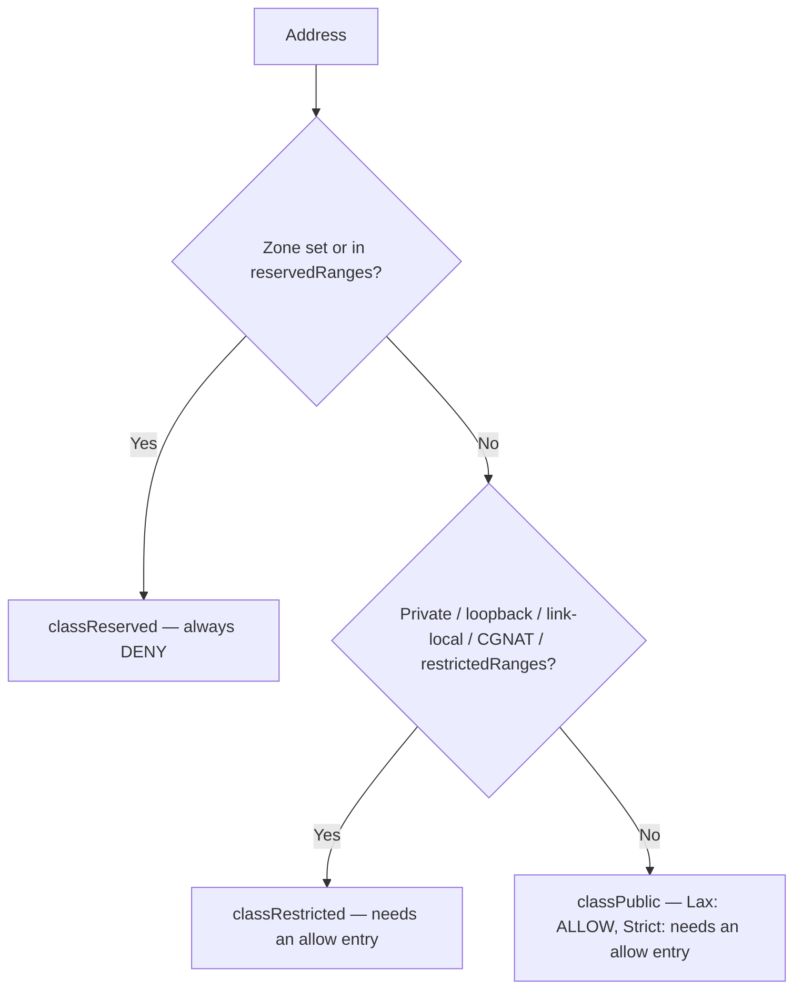

# Policy module design and decisions

This document is the living overview of the policy module: what it does, the contract it
enforces and where it is installed. The numbered documents next to it - `01-policy.md`,
`02-hostname-allows.md` - are [MADR](https://github.com/adr/madr)-style decision records:
they explain why a decision was made and are not updated when behavior changes.

## Context and problem statement

Gitea needs a centralized secure way to connect to external services that is clear to understand and straightforward
to use properly to secure against SSRF attacks.
The prior hostmatcher based approach was mixing two approaches (allow and block) in a single list,
making it difficult to interpret without running the code, leading to unclear behaviors.

The policy module is a replacement taking the parts hostmatcher did correctly and improving on the capabilities,
readability and flow.

## Contract

- `CheckHost`/`CheckHostIPs` screen a target URL without dialing; `NewDialContext` checks the resolved address at connect time, so DNS rebinding cannot bypass the lists.
- Always dial through the transport provided by the policy (`NewHTTPTransport`), never a bare `http.Transport`.
- A request the proxy selector sends to a proxy is not scanned — the proxy resolves the target. A direct request is always screened, including one whose target is the proxy's own address.

## Where the policy is enforced

Each outbound flow gets its own policy instance, wired in `policies.go`:

| Flow | Policy | Mode | Allowlist | Internal ranges | Blocklist | Proxy |
| --- | --- | --- | --- | --- | --- | --- |
| Migrations, mirrors, LFS | `NewMigrationPolicy` | `[migrations] EGRESS_MODE` | `[migrations] ALLOWED_HOST_LIST` | `[migrations] ALLOWED_INTERNAL_RANGES` | `[migrations] BLOCKED_HOST_LIST` | standard (`[proxy]`, env) |
| Git operations | `NewGitPolicy` | same as migrations | same as migrations | same as migrations | same as migrations | git's own (`[git.config] http.proxy`, `[proxy]`, env, `ALL_PROXY`) |
| Webhooks | `NewWebhookPolicy` | `[security] EGRESS_MODE` | `[webhook] ALLOWED_HOST_LIST` (defaults to `[security]`) | `[security] ALLOWED_INTERNAL_RANGES` | — | `[webhook] PROXY_URL`/`PROXY_HOSTS`, falls back to standard |
| OpenID, OAuth2 avatars | `NewSecurityPolicy` | `[security] EGRESS_MODE` | `[security] ALLOWED_HOST_LIST` | `[security] ALLOWED_INTERNAL_RANGES` | — | standard |

## Address pools

Policy relies on classification of addresses into pools: reserved, restricted and public. All can be found in [pools.go](pools.go)



Reserved pool keeps addresses which are never allowed by the policy for various reasons like
unscannable embedded addresses or addresses which are not meant to be dialed like broadcast or Azure WireServer.
Notably, it also matches IPv6 with zone as it has no valid use in this context as far as the module author is aware.

Restricted pool keeps addresses which are meant to be private or not in public use.
It may contain possibly dangerous addresses as long as they have some valid use like link-local.
Notably, apart from the addresses listed in code, it also contains private, loopback, cgnat and link-local unicast addresses.

The remaining addresses are classified as public.

For details on the classifier, see the `classifyAddr` function.

## The verification flow

The policy's primary check takes hostname and `netip.AddrPort` as input or infers them from `*url.URL` if possible,
and returns an error detailing why the address cannot be dialed if it cannot.

The overall flow of the check looks as follows:

1. The address is classified into a pool, rejected if the address is reserved.
2. The address and host are checked against the blocklist.
3. The address and host are checked against the allowlist.

The policy mode modifies the flow. In Lax mode, addresses classified as public are not checked
against the allowlist as they are assumed to be allowed implicitly. Strict mode requires everything to be on the allowlist.

## Rules

Policy uses rules to make the decisions. Those vary in behaviors with modes.
Each rule consists of a pattern or the prefix as well as the port range it matches.

Rules made for the blocklist default to all ports, Lax also uses this behavior.
Strict mode defaults to 80 and 443. Any other port must be given explicitly.

## On hostname allows

Hostname-based allows are supported via another setting. Adding the range to `ALLOWED_INTERNAL_RANGES`
does not allow the address to be dialed directly, but it allows it to be dialed via hostnames.
This is done to safeguard a module from an allowed domain (or subdomain) being hijacked and used to bypass safeguards,
using the domain to dial a malicious address. This only unlocks restricted addresses.

See [02-hostname-allows.md](02-hostname-allows.md) for why this solution was chosen.

## Modes

Policy has two modes of operation. Lax which allows all public addresses without needing to be on the allowlist,
and Strict which requires everything to be on the allowlist.
Blocklist works the same in both modes taking precedence.
Lax policy also assumes all ports are allowed unless specified otherwise.

## Host matching

Host matching is based on TLS rules - `example.com` matches only itself,
`*.example.com` matches all subdomains of example.com.
This is done to avoid confusion and to make it clear what is allowed, while supporting fine-grained control.
Blank allows like `*.` or `**` are not supported by design as they would negate the purpose of the module.

## Proxy

When a proxy is configured, requests that go through the proxy are not scanned.
This is deliberate and done for the following reasons:

- It provides an escape hatch for an administrator that wants to define their own policy or enforce a corporate one
- Checking it correctly is more challenging, and in deployments where all traffic must go through proxy
  and the main instance has no access to DNS, it would fail to validate the request.

The split is by role, not by address:

```
request → selector (`Policy.Proxy`) ── proxy chosen ──→ proxy dialer (`ProxyDialer`, unchecked: operator configuration)
                             └─ no proxy ───────→ policy dialer (`NewDialContext`, checked) → dial
```

When a proxy isn't configured, the address is from the localhost rangec or the host is somehow exempt from proxying,
the connection is direct and is always screened — including a direct request to the proxy's own address.

## Consequences

**Positive**: SSRF protection by default; per-component policies; blocklist override; dial-time DNS rebinding protection; hostname entries never cover restricted targets without an explicit range (`ALLOWED_INTERNAL_RANGES`); IPv6 support; port-level control.

**Negative**: matching logic is complex; operators must understand modes and per-component settings; minor DNS/classification overhead. Cloud metadata endpoints (AWS IMDS, Alibaba) are reachable when a range covering them is configured explicitly (`cgnat`, `169.254.0.0/16`, `fc00::/7`); targeted block entries can deny specific metadata IPs (migrations and git only). Startup validation of `ALLOWED_INTERNAL_RANGES` is a future consideration (item 5).

**Proxy caveat**: when a proxy is configured, the egress policy does not check the target — the dial goes to the proxy and the proxy is expected to enforce restrictions. This is a trust delegation, not enforcement. Direct requests are still screened, so the proxy's own listener is not reachable through a direct request.

**Upgrade note**: restricted targets are denied by default, so existing webhooks, migrations and remotes pointing at internal hosts start failing after upgrade until they are allow-listed (via an IP entry or `ALLOWED_INTERNAL_RANGES`). Hostname entries match the exact host only — previously an apex entry covered subdomains (`NO_PROXY`-style); add `*.example.com` to keep subdomain coverage.

## Roadmap

### Future considerations

1. **Dynamic updates** — reload policies without restart. Live reload isn't supported in Gitea currently; worth checking whether the design (policies built from setting strings at each use) can be adjusted to enable reloading.
2. **Metrics** — telemetry for policy violations.
3. **Audit logging** — dial-time denials are logged at Warn (`egress denied: ...` from `NewDialContext`); name-level pre-checks (`CheckHost`/`CheckHostIPs`) are not logged yet.
4. **Admin overrides** — exempt admins from scans. Would require the module to be user-aware, which is linked to per-repository/organization awareness (item 7).
5. **Startup validation of `ALLOWED_INTERNAL_RANGES`** — currently the setting is parsed silently: invalid entries are dropped without a log line, and no warning fires when a range overlaps cloud metadata endpoints (AWS `169.254.169.254` / `fd00:ec2::254`, Alibaba `100.100.100.200`) or when hostname allow entries gain non-public coverage within the ranges. Future consideration: report dropped entries and warn on metadata overlap and widening at startup, and run the well-known metadata IPs against the actual policies to check whether they would be allowed.
6. **Proxy configuration warning** — at startup, warn when a proxy is configured alongside egress policies that the policy does not IP-check proxied targets.
7. **Per-repository/organization overrides** — policies are instance-wide; per-repo/org overrides would be a future extension and would also enable user-aware features (admin exemption, item 4).
8. **IDN/Unicode entries** — hostname entries must be given as punycode; supporting Unicode entries is a future extension if there's a request for it.

### Open questions

- **Lax port scoping** — in Lax mode public targets bypass the allowlist, so a port-scoped entry for a public host is a no-op. Worth revisiting: portless entries could default to all ports while port-scoped entries limit ports for public hosts in Lax too.
- **Dead entries** — 4-in-6 CIDRs (`::ffff:10.0.0.0/104`) and fully reserved ranges (e.g. `224.0.0.0/4`) parse fine but never match; a startup warning names them. Partially reserved prefixes (e.g. `0.0.0.0/7`, which includes dialable `1.0.0.1`) still match and are not flagged.
